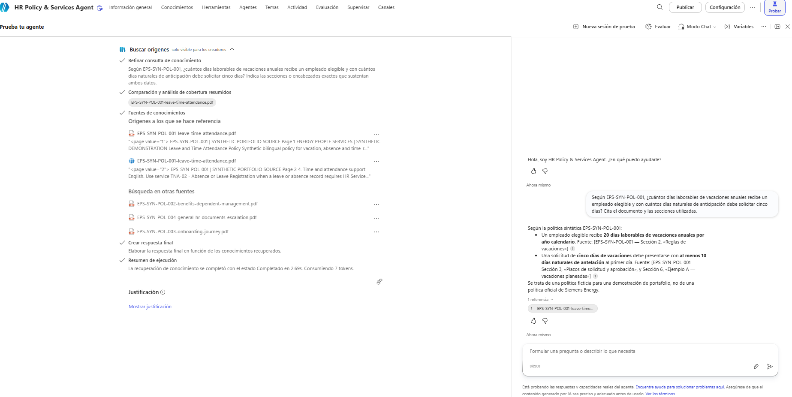
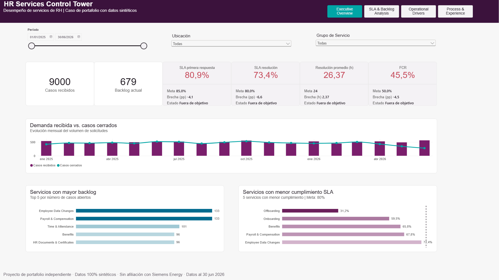
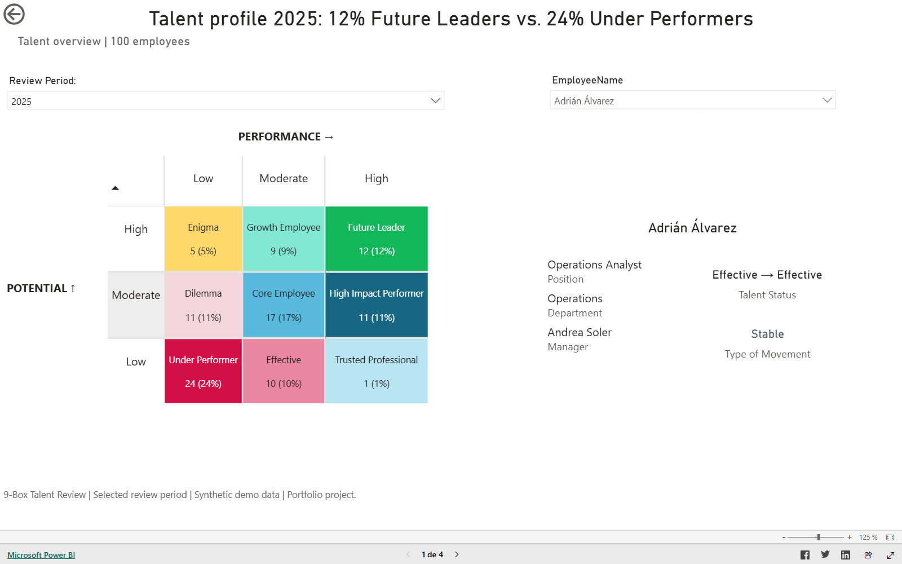

# People Analytics & Digital HR Portfolio

I build decision-support products that connect HR processes, workforce data, and business operations.

I’m building this portfolio around People Analytics, HR Data, HR Services, process improvement, and responsible AI.

[Español](README.md)

## Completed work

### Project 3 — HR Data Quality & Lifecycle Workbench

A Digital HR case connecting workforce-data inconsistency detection with investigation and tracking through Fabric, Power Apps, Dataverse, Power Automate, and Power BI.

[Explore the full case study](projects/hr-data-quality-lifecycle-workbench/README.en.md) · [Review the technical route](projects/hr-data-quality-lifecycle-workbench/docs/technical-overview.en.md)

### Project 2 — HR Policy & Services Agent

A bilingual HR self-service agent that answers with evidence, cites policy sources, detects knowledge gaps, and creates synthetic service requests with confirmation and safe human escalation.

[Explore the full case study](projects/hr-policy-services-agent/README.en.md) · [Watch the end-to-end demonstration](projects/hr-policy-services-agent/README.en.md#end-to-end-demonstration)

### Project 1 — HR Services Control Tower

An end-to-end Power BI case for monitoring HR service demand, SLA, backlog, capacity, process quality, and employee experience using reproducible synthetic data.

[Open the live Power BI report](https://app.powerbi.com/view?r=eyJrIjoiMjU5MDEzODEtMDBkMi00MmUzLTlhNTgtMmQ4N2E1NDkyZDM2IiwidCI6ImY4NGNiMmZiLTQ0MDgtNDcxMC05NWY5LTQwYjBmMThlZDQ3ZiIsImMiOjR9) · [Explore the full case study](projects/hr-services-control-tower/README.en.md)

### Project 0 — Talent Review & Calibration

A Power BI case for understanding talent distribution, year-over-year movement, rating consistency, and department-level talent risk using synthetic data.

[Open the live Power BI report](https://app.powerbi.com/view?r=eyJrIjoiMjM2NGFkZjYtOWNiNy00MWZhLWJjOGEtYzY5ZGZhZTk2N2E3IiwidCI6ImY4NGNiMmZiLTQ0MDgtNDcxMC05NWY5LTQwYjBmMThlZDQ3ZiIsImMiOjR9) · [Explore the full case study](projects/talent-review-calibration/README.en.md)

## Positioning

My goal is to grow as an **HR Analytics & Digital HR professional**: someone who understands people processes and turns them into reliable indicators, better services, and decision-ready systems.

> All portfolio datasets are synthetic or privacy-safe. Projects are learning and demonstration artifacts, not production HR decision systems.
