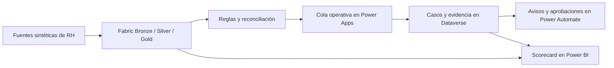

# Proyecto 3: HR Data Quality & Lifecycle Workbench

Caso end-to-end de Digital HR que convierte registros laborales dispersos en excepciones de calidad trazables, trabajo humano de remediación y evidencia preparada para decisiones.

[← Volver al portafolio](../../README.es.md) · [English](README.md)

> Proyecto independiente de portafolio. No es un sistema oficial ni está afiliado o respaldado por Siemens Energy. Los registros laborales, resultados y escenarios son sintéticos. El autor puede aparecer únicamente como propietario de registros creados en el entorno de demostración.

## Resumen ejecutivo

Los datos de RH pueden ser válidos en archivos separados y volverse poco confiables al combinar empleados, movimientos y estructura organizacional. Este proyecto detecta esos conflictos, envía las excepciones relevantes a una cola controlada y conserva la evidencia de cada resolución.

La solución conecta Microsoft Fabric, Power Apps, Dataverse, Power Automate y Power BI. Mantiene separadas la analítica y la operación: Fabric calcula y conserva las excepciones; las personas investigan y aprueban la remediación en Power Apps; Power BI muestra si la calidad mejora o si los casos solamente se cierran de forma administrativa.

## La experiencia

El workbench operativo ayuda al data steward a priorizar excepciones y revisar responsable, corrección del origen, evidencia y preparación para aprobación en un solo lugar.

El scorecard ejecutivo resume calidad actual, riesgo recurrente, casos publicados y eficacia de remediación sin asumir que cerrar un caso equivale a corregir el origen.

## De la incidencia a la evidencia

1. Tres fuentes sintéticas representan el snapshot de empleados, eventos de ciclo de vida y referencias organizacionales.
2. Ocho reglas detectan problemas de completitud, validez, unicidad, consistencia, integridad referencial, temporalidad y oportunidad.
3. Solo un subconjunto controlado de excepciones se publica en Dataverse para remediación humana.
4. Power Automate coordina asignación, aprobación, timeout y manejo de errores.
5. Power BI reconcilia el riesgo analítico con el estado operativo de los casos publicados.

[Consultar arquitectura y decisiones técnicas](docs/technical-overview.es.md)

## Hallazgos seleccionados

- El Data Quality Score sintético actual llega a **98.9%**, **0.7 puntos porcentuales** por encima del corte anterior.
- Los seis cortes contienen **923 instancias de excepción** en ocho reglas; la consistencia entre sistemas concentra el mayor volumen.
- Se publicaron deliberadamente **cinco casos** de la población analítica y **tres continúan abiertos**.
- El reporte distingue resolución de corrección confirmada en el origen y hace visibles los cierres que aún no tienen esa confirmación.

Estos resultados son patrones diseñados para demostración, no hallazgos de una organización real.

## Validación

| Control | Resultado |
|---|---:|
| Generador sintético | 7/7 pruebas aprobadas |
| Generative Page | Typecheck + 5/5 pruebas de componente |
| Controles Power Platform | Asignación, aprobación, rechazo, waiver, timeout, Catch e idempotencia validados |
| Proyecto Power BI | 0 errores · 0 advertencias |
| Higiene del repositorio | Credenciales, sesión, caché y configuración local excluidas |

[Revisar el manifiesto reducido de evidencia](evidence/phase-9/evidence-manifest.es.md) · [Consultar el gate de pruebas y publicación](docs/phase-9-test-and-publication-plan.es.md)

## Explorar la implementación

- [Arquitectura, límites y mapa del repositorio](docs/technical-overview.es.md)
- [Diseño y granularidad de datos](docs/data-design.es.md)
- [Reglas de calidad y comportamiento esperado](docs/quality-rules.es.md)
- [Implementación en Fabric](docs/fabric-implementation.es.md)
- [Diseño de Dataverse](docs/dataverse-design.es.md)
- [Arquitectura de Power Apps](docs/generative-page-architecture.es.md)
- [Diseño y controles de Power Automate](docs/phase-7-automation-design.es.md)
- [Diseño de Power BI](docs/phase-8-bi-design.es.md)
- [Guía opcional para grabar el video](docs/video-recording-guide.es.md)

Los parámetros públicos de Power BI utilizan valores de ejemplo seguros. Antes de actualizar, deben sustituirse en Power BI Desktop por el endpoint SQL de Fabric, la base del Lakehouse y el entorno de Dataverse propios.

## Uso responsable

- No se incluyen datos reales de empleados, salario, información médica, desempeño ni otros atributos sensibles.
- El workbench apoya la investigación humana; no modifica automáticamente un HRIS.
- Los cambios relevantes conservan evidencia y aprobación sin ocultar la excepción original.
- El reporte diferencia población analítica, casos publicados, resolución administrativa y corrección confirmada del origen.

## Autor

Miguel — [Perfil de GitHub](https://github.com/MiguelPR-99)
