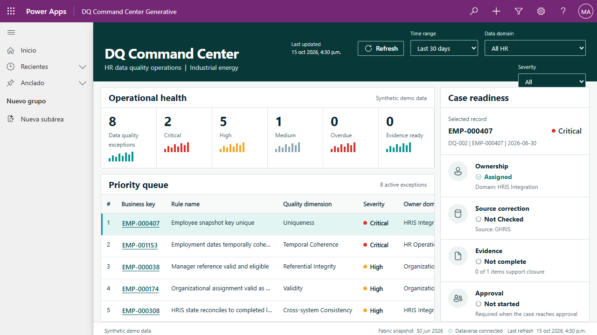
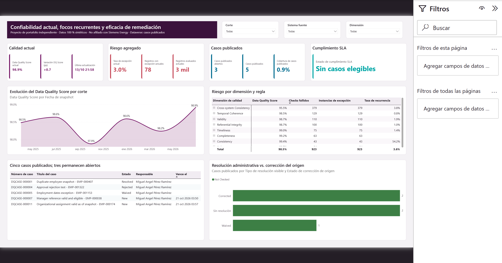
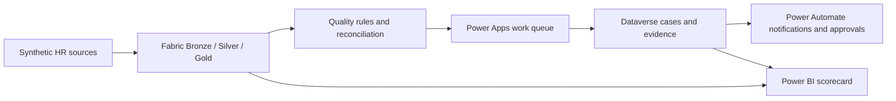

# Project 3: HR Data Quality & Lifecycle Workbench

An end-to-end Digital HR case that turns fragmented workforce records into traceable data-quality exceptions, human remediation work, and decision-ready evidence.

[← Back to portfolio](../../README.md) · [Español](README.es.md)

> Independent portfolio project. It is not an official system and is not affiliated with or endorsed by Siemens Energy. Workforce records, business results, and scenarios are synthetic. The author may appear only as the owner of records created in the demonstration environment.

## Executive summary

HR data can be technically valid in separate files and still become unreliable when worker, lifecycle, and organization records are combined. This project detects those conflicts, sends the relevant exceptions to a controlled work queue, and preserves the evidence behind each resolution.

The solution connects Microsoft Fabric, Power Apps, Dataverse, Power Automate, and Power BI. It keeps analytics and transactional work separate: Fabric calculates and preserves exceptions; people investigate and approve remediation in Power Apps; Power BI shows whether data quality is improving or cases are only being closed administratively.

## The experience

The operational workbench helps a data steward prioritize exceptions and review ownership, source correction, evidence, and approval readiness in one place.

The executive scorecard summarizes current quality, recurring risk, published cases, and remediation effectiveness without implying that case closure equals source correction.

## From issue to evidence

1. Three synthetic sources represent worker snapshots, lifecycle events, and organizational reference data.
2. Eight rules detect completeness, validity, uniqueness, consistency, referential, temporal, and timeliness issues.
3. Only a controlled subset of exceptions is published to Dataverse for human remediation.
4. Power Automate coordinates assignment, approval, timeout, and error handling.
5. Power BI reconciles analytical risk with the operational state of published cases.

[Read the technical overview and design decisions](docs/technical-overview.md)

## Selected findings

- The current synthetic data-quality score reaches **98.9%**, up **0.7 percentage points** from the previous snapshot.
- The six snapshots contain **923 exception instances** across eight rules; cross-system consistency carries the largest volume.
- **Five cases** were deliberately published from the larger analytical population, with **three still open**.
- The report distinguishes a resolution from confirmed source correction, exposing closures that still lack origin-system confirmation.

These results are designed demonstration patterns, not findings about a real organization.

## Verification

| Control | Result |
|---|---:|
| Synthetic generator | 7/7 tests passed |
| Generative Page | Typecheck + 5/5 component tests |
| Power Platform controls | Assignment, approval, rejection, waiver, timeout, Catch, and idempotency validated |
| Power BI project | 0 errors · 0 warnings |
| Repository hygiene | Credentials, authentication state, cache, and local settings excluded |

[Review the reduced evidence manifest](evidence/phase-9/evidence-manifest.md) · [Read the Phase 9 test and publication gate](docs/phase-9-test-and-publication-plan.es.md)

## Explore the implementation

The implementation deliberately separates analytical work from operational work:

1. Synthetic sources create a repeatable problem without using real workforce information.
2. Fabric retains the full population and turns cross-system conflicts into explainable exceptions.
3. Only prioritized exceptions move to Dataverse, preventing the full analytical population from becoming an operational queue.
4. Power Apps supports human investigation; Power Automate coordinates asynchronous steps and approvals.
5. Power BI reconciles analytical trends with case progress without treating administrative closure as proof of source correction.

[Follow the technical narrative and its decisions](docs/technical-overview.md). The journey links to models, rules, automations, tests, and other reproducible artifacts when that additional detail is useful.

The public Power BI parameters use safe example values. Replace them in Power BI Desktop with your own Fabric SQL endpoint, Lakehouse database, and Dataverse environment before refreshing.

## Responsible use

- No real employee data, salary, medical, performance, or other sensitive attributes are included.
- The workbench supports human investigation; it does not change a source HR system automatically.
- Material changes retain evidence and approval rather than hiding the original exception.
- The report separates analytical population, published cases, administrative resolution, and confirmed source correction.

## Author

Miguel — [GitHub profile](https://github.com/MiguelPR-99)
