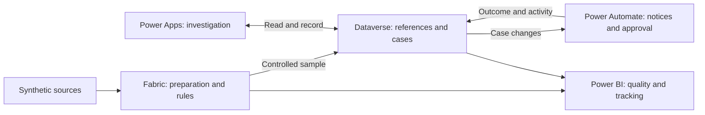

# Project 3 technical walkthrough

[← Case study](../README.en.md) · [Español](technical-overview.md)

This walkthrough follows an inconsistency from the source files through investigation and tracking. Fabric retains the full analytical population; Dataverse records the work on a sample of exceptions. Power Apps, Power Automate, and Power BI use these two perspectives for different purposes. Detailed implementation records linked below are retained in Spanish.



## 1. Build a repeatable scenario

Three sources represent employee records, lifecycle events, and organizational references. The generator uses a fixed seed and introduces known anomalies so the scenario can be regenerated and checked against the rules.

For example, DQ-007 compares the employee record with completed events that should already be reflected in it. It allows two business days for synchronization before flagging a discrepancy. This distinguishes an accepted delay from a conflict requiring review.

[Data design](data-design.es.md) · [Rules and tolerances](quality-rules.es.md) · [Generator validation](synthetic-data-validation.es.md)

## 2. Prepare and evaluate data in Fabric

Bronze preserves the original files. Silver normalizes types and structure and flags ambiguities such as duplicate keys. Gold evaluates the eight rules and prepares exceptions, recurrence, and the views consumed by Power BI.

Retaining history makes it possible to check whether an issue reappears across snapshots, even when no case was created to investigate it. The notebooks use PySpark; SQL views define the consumption outputs and export sample.

[Fabric implementation](fabric-implementation.es.md) · [Notebooks](../notebooks/) · [SQL views](../sql/)

## 3. Select exceptions and record cases in Dataverse

An exception is the result of a failed rule. A published reference retains its data in Dataverse. A case is the operational record opened to investigate it. These three entities do not represent the same volume.

The demonstration load selects eight references, one per rule, using a SQL query and an import. This sample supports a walkthrough of different issue types; it is not an automatic prioritization engine or a continuous Fabric integration.

Dataverse stores cases, owners, activities, evidence, and statuses. Alternate keys prevent duplicate cases for the same exception instance; relationships and auditing retain the link to the detected issue. The original reference stays separate from the editable investigation record.

[Export query](../sql/03_export_dataverse_demo_exceptions.sql) · [Dataverse model](dataverse-design.es.md) · [Data and control verification](phase-5-gate-review.es.md)

## 4. Investigate through Power Apps

The Command Center is a Generative Page built with React and TypeScript. It queries Dataverse through supported APIs and lets users filter exceptions, inspect context, and create or open a case. Full editing continues in the model-driven application.

During testing, the original button opened an empty form with locked required technical fields. The fix retained those restrictions: the application now creates the case with its reference, initial status, owner, and timestamps before opening it by GUID. A creation test against the published application checked this flow.

[Interface architecture](generative-page-architecture.es.md) · [Power Apps iteration and tests](phase-6-gate-review.es.md) · [Application code](../power-apps/)

## 5. Coordinate notifications and approvals with Power Automate

Power Automate handles tasks that must continue after the screen closes: notifying an owner of an assignment, validating an approval request, waiting for the response, and recording the outcome.

The flows check evidence and conditions before requesting approval. They retain identifiers to avoid duplicate execution and record errors or approval timeouts. Decisions remain associated with the case in Dataverse.

The verification documents approval, rejection, waiver, and timeout. Reassignment between two users was not tested because the environment had one identity; recurring SLA reminders remain pending.

[Flow design](phase-7-automation-design.es.md) · [Verification results and limits](phase-7-gate-review.es.md)

## 6. Bring quality and tracking together in Power BI

The model combines Fabric Gold views with Dataverse operational tables using Import. This supports refreshing and reconciling both sources at the demonstration volume. The model and report are retained as PBIP, TMDL, and PBIR files.

The report distinguishes case status from source-correction confirmation. Resolving or waiving a case does not prove that the next snapshot will stop producing the exception. The application does not write to a real HR system.

The published screenshot shows six snapshots containing 923 exception instances, five created cases, and three open cases. Instances can include issues recurring across snapshots; they do not represent 923 employees or 923 distinct cases.

The final score of 98.9% is the weighted proportion of eligible checks that passed, with higher weights for more severe checks. It is not the percentage of employees without errors. The +0.7 percentage-point change belongs to the synthetic scenario and does not demonstrate an effect of the automations.

[Power BI design and denominators](phase-8-bi-design.es.md) · [Result reconciliation](phase-8-gate-review.es.md) · [Model and report](../power-bi/)

## AI-assisted development and testing

I used AI assistance during development, alongside MCP for semantic-model operations and command-line tools for generating and validating artifacts. The project includes type checks, component tests, Playwright tests, and visual review. AI is part of the development process; the solution's quality rules are explicit and deterministic.

The evidence distinguishes what was executed at each stage. Phases 6 and 7 document tests against the published application and a controlled creation test. The local regression on October 18, 2026 did not repeat browser tests, visual comparisons, or record creation.

[Evidence and test coverage](../evidence/phase-9/evidence-manifest.en.md)

## Scope and next steps

The demonstration uses synthetic data and a development environment. Applying it to a real operation would require agreeing on selection criteria with the team, integrating correction with source-system owners, and reviewing access, retention, incremental loading, performance, cost, and deployment between environments. Testing with different security profiles and real users also remains pending.

## References for reproduction or extension

[Data dictionary](data-dictionary.es.md) · [Power Platform operations](power-platform-maintenance.es.md) · [Test and publication plan](phase-9-test-and-publication-plan.es.md)

From the project folder:

```powershell
python -m unittest discover -s scripts/tests -v
powershell -NoProfile -ExecutionPolicy Bypass -File scripts/verify_phase9.ps1
```

Before refreshing Power BI, replace the example parameters with your Fabric SQL endpoint, Lakehouse database, and Dataverse environment. Credentials and local configuration are not included in the repository.
