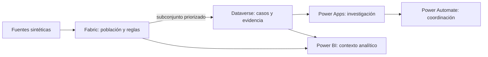

# Del conflicto de datos a una decisión trazable

[← Caso principal](../README.es.md) · [English](technical-overview.md)

Esta es la ruta técnica del Proyecto 3. Explica cómo cada componente recibe un problema concreto, resuelve únicamente la parte que le corresponde y entrega un resultado verificable al siguiente. Los detalles de implementación permanecen enlazados como referencia para no interrumpir la historia principal.

## La decisión que organiza la arquitectura

El proyecto separa dos necesidades relacionadas, pero distintas:

- **Entender la calidad de toda la población:** requiere historia, volumen, reglas repetibles y análisis de recurrencia.
- **Remediar casos seleccionados:** requiere responsables, estados, evidencia, aprobaciones y auditoría.

Fabric atiende la primera necesidad. Dataverse y Power Platform atienden la segunda. Esta separación evita usar una aplicación transaccional como almacén analítico o convertir cada error detectado en trabajo humano.



## 1. Crear un problema que se pueda repetir

El punto de partida no fue un dashboard, sino tres fuentes sintéticas que representan snapshots de empleados, eventos de ciclo de vida y referencias organizacionales. Por separado pueden parecer válidas; al reconciliarlas aparecen duplicados, secuencias imposibles, referencias ausentes y diferencias entre sistemas.

Una semilla fija y contratos versionados permiten regenerar el mismo escenario, probar cada regla y publicar el proyecto sin exponer datos reales. Los archivos no intentan reproducir la complejidad completa de un HRIS productivo: proporcionan un laboratorio controlado para demostrar el proceso.

**Decisión clave:** introducir anomalías conocidas permite comprobar que una regla detecta el problema correcto, no solo que produce resultados.

[Diseño y granularidad de los datos](data-design.es.md) · [Validación del escenario sintético](synthetic-data-validation.es.md)

## 2. Conservar la población analítica en Fabric

Fabric recibe los archivos y preserva su recorrido por capas. Bronze mantiene el material de origen; Silver normaliza tipos y estructura sin ocultar problemas; Gold evalúa reglas, calcula recurrencia y prepara vistas de consumo.

Fabric conserva también las excepciones que nunca se convierten en casos. Esto permite responder preguntas como: ¿la calidad está mejorando?, ¿qué regla reaparece?, ¿cuánto riesgo existe fuera de la cola operativa? Dataverse no asume esta responsabilidad porque está orientado a transacciones gobernadas, no a conservar y recalcular toda la historia analítica.

**Límite:** el proyecto demuestra contratos, transformaciones y reconciliación con una escala sintética. En producción habría que revisar particionamiento, carga incremental, rendimiento, observabilidad y acuerdos de datos con cada fuente.

[Implementación de Fabric](fabric-implementation.es.md) · [Reglas de calidad](quality-rules.es.md) · [`notebooks/`](../notebooks/) · [`sql/`](../sql/)

## 3. Convertir detecciones en trabajo deliberado

Una excepción analítica indica que una regla falló; no significa automáticamente que una persona deba abrir un caso. Publicar las 923 instancias sintéticas habría duplicado la población, generado ruido y desviado Dataverse hacia una función de almacenamiento que ya cumple Fabric.

Por eso el proyecto publica solo un subconjunto priorizado. Cada caso conserva una clave que lo relaciona con la excepción analítica, mientras Fabric mantiene la visión completa. La selección puede evolucionar hacia criterios de severidad, recurrencia, materialidad o capacidad operativa sin cambiar la separación arquitectónica.

**Respuesta de entrevista — ¿por qué no publicar todas las excepciones?** Porque detectar y remediar tienen costos y ritmos distintos. La publicación controlada protege la capacidad del equipo y mantiene visible el riesgo que todavía no ha sido convertido en caso.

[Vista de exportación controlada](../sql/03_export_dataverse_demo_exceptions.sql) · [Diseño de Dataverse](dataverse-design.es.md)

## 4. Utilizar Dataverse como registro operativo

Dataverse organiza casos, actividades, evidencia, responsables y estados en un modelo transaccional con identidad y auditoría. Es adecuado para esta parte porque Power Apps y Power Automate pueden trabajar sobre las mismas entidades y reglas de seguridad sin crear una base operativa paralela.

Su función no es recalcular calidad ni reemplazar el Lakehouse. Recibe únicamente lo necesario para gestionar una intervención y conserva su historial. Esta frontera facilita distinguir la excepción original, el caso publicado y las acciones tomadas para resolverlo.

**Respuesta de entrevista — ¿por qué Dataverse?** Porque el problema operativo necesita propiedad, estados, relaciones, evidencia y controles transaccionales; el problema analítico necesita historia completa y procesamiento a escala. Son responsabilidades diferentes.

**Revisión productiva:** roles por equipo, seguridad de campo, retención, capacidad, políticas DLP, soluciones administradas y despliegues entre entornos.

[Modelo y decisiones de Dataverse](dataverse-design.es.md) · [`dataverse/`](../dataverse/)

## 5. Dar contexto a la investigación en Power Apps

El Command Center ayuda a priorizar y entender excepciones; la aplicación basada en modelo protege la captura de actividades, evidencia y transiciones del caso. La interfaz reúne contexto que de otro modo estaría fragmentado, pero deja las reglas analíticas en Fabric y la coordinación asíncrona en Power Automate.

Esta decisión mantiene la experiencia enfocada en el juicio humano: investigar, documentar y determinar si un caso está listo para aprobación. La aplicación no modifica un HRIS ni declara por sí sola que el origen quedó corregido.

**Límite:** las pruebas validan componentes, navegación y un tenant de desarrollo. Una implementación productiva requeriría pruebas de accesibilidad, dispositivos, rendimiento, perfiles de seguridad y aceptación con usuarios reales.

[Arquitectura de Power Apps](generative-page-architecture.es.md) · [`power-apps/`](../power-apps/)

## 6. Coordinar el proceso con Power Automate

Power Automate se ocupa de lo que no debería depender de una pantalla abierta: asignación, notificaciones, espera de aprobación, timeout, idempotencia y registro de errores. Power Apps inicia o muestra el proceso; los flujos conservan su continuidad y dejan evidencia de ejecución.

La automatización tampoco sustituye la decisión humana. Verifica condiciones, mueve información y aplica rutas aprobadas, pero la evaluación de la evidencia permanece en el proceso gobernado.

**Respuesta de entrevista — ¿qué aporta frente a Power Apps?** Power Apps gestiona la interacción; Power Automate orquesta eventos y tareas asíncronas. Separarlos evita incrustar un proceso de larga duración en la interfaz.

**Revisión productiva:** cuentas de servicio, propietarios alternos, monitoreo, alertas, políticas de reintento, límites del conector y estrategia de soporte.

[Diseño de automatización](phase-7-automation-design.es.md) · [Validación del gate](phase-7-gate-review.es.md)

## 7. No confundir cierre con corrección

Un caso puede cerrarse porque fue rechazado, dispensado o resuelto administrativamente. Ninguno de esos estados demuestra por sí solo que la próxima extracción del sistema fuente dejará de producir la excepción.

El proyecto conserva por separado el resultado del caso y la confirmación de corrección del origen. La prueba más sólida aparece cuando un corte posterior ya no reproduce el problema; mientras eso no ocurra, Power BI mantiene visible la diferencia.

**Respuesta de entrevista — ¿por qué importa?** Porque medir solo casos cerrados puede premiar velocidad administrativa sin demostrar una mejora real en los datos.

## 8. Reconciliar análisis y operación en Power BI

El scorecard combina dos perspectivas. Fabric aporta la población total, las tendencias y las reglas; Dataverse aporta los casos publicados, sus responsables y el resultado operativo. Power BI relaciona ambas sin asumir que representan el mismo universo.

Si el reporte utilizara solo Dataverse, ignoraría las excepciones no publicadas. Si utilizara solo Fabric, no podría explicar el avance de investigación y aprobación. La reconciliación permite mostrar simultáneamente el riesgo detectado, la cobertura operativa y la evidencia de corrección.

**Límite:** el modelo público utiliza parámetros de ejemplo y una muestra pequeña. Producción exigiría revisar seguridad a nivel de fila, actualización, gateway o identidad, rendimiento DAX, accesibilidad, distribución y monitoreo del modelo semántico.

[Diseño de Power BI](phase-8-bi-design.es.md) · [`power-bi/`](../power-bi/)

### Flujo de autoría asistido por IA

La construcción utilizó un flujo agéntico para acelerar tareas repetibles: MCP para operar el modelo semántico, CLI y artefactos PBIP/TMDL/PBIR para generar y validar el reporte, y Playwright para comprobaciones reproducibles de la experiencia web. El control de versiones, los gates automáticos y la revisión visual limitaron el riesgo de aceptar resultados generados sin verificación.

## Qué faltaría para producción

Antes de utilizar este patrón con datos laborales reales sería necesario revisar:

- clasificación, minimización, retención y acceso a datos;
- identidades administradas, secretos, conexiones y segregación de funciones;
- soluciones, variables de entorno y pipelines de despliegue;
- escalabilidad, actualización incremental, rendimiento y costos;
- monitoreo conjunto de Fabric, Power Platform y Power BI;
- criterios formales para publicar, priorizar y cerrar casos;
- integración gobernada con los propietarios de los sistemas de origen.

La solución publicada demuestra la arquitectura y sus controles; no representa un despliegue productivo multientorno ni escribe en un HRIS real.

## Referencia reproducible

Los siguientes recursos conservan el detalle para quien necesite auditar o extender la solución:

- [Diccionario de datos](data-dictionary.es.md)
- [Gate de Fabric](phase-4-gate-review.es.md)
- [Gate de Dataverse](phase-5-gate-review.es.md)
- [Gate de Power Apps](phase-6-gate-review.es.md)
- [Gate de Power Automate](phase-7-gate-review.es.md)
- [Gate de Power BI](phase-8-gate-review.es.md)
- [Gate de publicación](phase-9-test-and-publication-plan.es.md)
- [Manifiesto reducido de evidencia](../evidence/phase-9/evidence-manifest.es.md)
- [Guía opcional para grabar el video](video-recording-guide.es.md)

Desde la carpeta del proyecto, la regresión pública puede ejecutarse con:

```powershell
python -m unittest discover -s scripts/tests -v
powershell -NoProfile -ExecutionPolicy Bypass -File scripts/verify_phase9.ps1
```

Las credenciales, sesiones, caché y configuración local están excluidas del repositorio. Los parámetros públicos de conexión utilizan valores seguros de ejemplo y deben sustituirse antes de actualizar el modelo.
