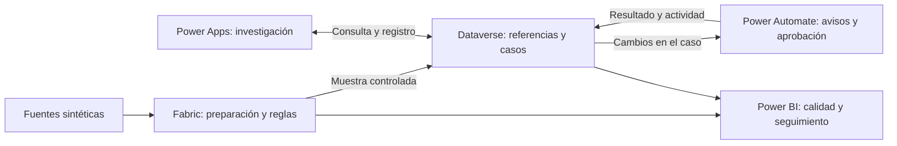

# Recorrido técnico del proyecto 3

[← Caso principal](../README.md) · [English](technical-overview.en.md)

El recorrido sigue una inconsistencia desde los archivos de origen hasta su investigación y seguimiento. Fabric conserva el análisis completo; Dataverse registra el trabajo sobre una muestra de excepciones. Power Apps, Power Automate y Power BI utilizan esas dos perspectivas con responsabilidades distintas.



## 1. Construir un escenario repetible

Tres fuentes representan el registro de empleados, los eventos de ciclo de vida y las referencias organizacionales. El generador utiliza una semilla fija e introduce anomalías conocidas, de modo que el escenario se puede regenerar y contrastar con las reglas.

Por ejemplo, la regla DQ-007 compara el estado del empleado con los eventos completados que ya deberían estar reflejados en él. Permite dos días hábiles de sincronización antes de señalar una discrepancia. Así distingue una demora aceptada de un conflicto que necesita revisión.

[Diseño de datos](data-design.es.md) · [Reglas y tolerancias](quality-rules.es.md) · [Validación del generador](synthetic-data-validation.es.md)

## 2. Preparar y evaluar los datos en Fabric

Bronze conserva los archivos originales. Silver normaliza tipos y estructura, y marca ambigüedades como claves duplicadas. Gold evalúa las ocho reglas y prepara las excepciones, la recurrencia y las vistas que consume Power BI.

Mantener el historial permite revisar si un problema reaparece entre cortes, incluso cuando nunca se creó un caso para investigarlo. Los notebooks utilizan PySpark; las vistas SQL definen las salidas de consumo y la muestra de exportación.

[Implementación de Fabric](fabric-implementation.es.md) · [Notebooks](../notebooks/) · [Vistas SQL](../sql/)

## 3. Seleccionar excepciones y registrar casos en Dataverse

Una excepción es el resultado de una regla fallida. Una referencia publicada conserva sus datos en Dataverse. Un caso es el registro operativo que se abre para investigarla. Esas tres entidades no representan el mismo volumen.

La carga de demostración selecciona ocho referencias, una por regla, mediante una consulta SQL y una importación. La muestra permite recorrer distintos tipos de problema; no representa un motor automático de priorización ni una integración continua con Fabric.

Dataverse conserva casos, responsables, actividades, evidencia y estados. Las claves alternativas evitan duplicar un caso para la misma instancia de excepción; las relaciones y la auditoría mantienen el vínculo con lo detectado. La referencia original permanece separada del registro editable de investigación.

[Consulta de exportación](../sql/03_export_dataverse_demo_exceptions.sql) · [Modelo de Dataverse](dataverse-design.es.md) · [Verificación de datos y controles](phase-5-gate-review.es.md)

## 4. Investigar desde Power Apps

El Command Center es una Generative Page con React y TypeScript. Consulta Dataverse mediante las API soportadas y permite filtrar excepciones, revisar contexto y crear o abrir el caso. La edición completa continúa en la aplicación basada en modelo.

Durante las pruebas, el botón inicial abría un formulario vacío cuyos campos técnicos obligatorios estaban bloqueados. La corrección mantuvo esas restricciones: ahora crea el caso con su referencia, estado inicial, responsable y marcas temporales antes de abrirlo por GUID. Una prueba de creación contra la aplicación publicada comprobó ese recorrido.

[Arquitectura de la interfaz](generative-page-architecture.es.md) · [Iteración y pruebas de Power Apps](phase-6-gate-review.es.md) · [Código de la aplicación](../power-apps/)

## 5. Coordinar avisos y aprobaciones con Power Automate

Power Automate se ocupa de tareas que deben continuar aunque la pantalla se cierre: avisar de una asignación, validar una solicitud de aprobación, esperar la respuesta y registrar el resultado.

Los flujos comprueban evidencia y condiciones antes de solicitar aprobación. Conservan identificadores para evitar ejecuciones duplicadas y registran errores o vencimientos de espera. Las decisiones quedan asociadas al caso en Dataverse.

La verificación documenta aprobación, rechazo, exención y timeout. La reasignación entre dos usuarios no se probó porque el entorno tenía una sola identidad; los recordatorios periódicos de SLA quedan pendientes.

[Diseño de los flujos](phase-7-automation-design.es.md) · [Resultados y límites de la verificación](phase-7-gate-review.es.md)

## 6. Reunir calidad y seguimiento en Power BI

El modelo combina las vistas Gold de Fabric con las tablas operativas de Dataverse mediante Import. Esta elección permite actualizar y reconciliar ambas fuentes para el volumen de la demostración. El modelo y el reporte se conservan como archivos PBIP, TMDL y PBIR.

El reporte distingue el estado del caso de la confirmación de corrección del origen. Resolverlo o conceder una exención no demuestra que el próximo corte dejará de producir la excepción. La aplicación no escribe en un sistema real de RH.

En la captura publicada se observan seis cortes con 923 instancias de excepción, cinco casos creados y tres abiertos. Las instancias pueden incluir problemas que reaparecen entre cortes; no equivalen a 923 empleados ni a 923 casos distintos.

El score final de 98.9% es la proporción ponderada de comprobaciones elegibles que aprobaron, con mayor peso para las de mayor severidad. No es el porcentaje de empleados sin errores. La variación de +0.7 puntos porcentuales pertenece al escenario sintético y no demuestra un efecto de las automatizaciones.

[Diseño y denominadores de Power BI](phase-8-bi-design.es.md) · [Reconciliación de resultados](phase-8-gate-review.es.md) · [Modelo y reporte](../power-bi/)

## Desarrollo asistido por IA y pruebas

Utilicé IA para apoyar la construcción, junto con MCP para operar el modelo semántico y herramientas de línea de comandos para generar y validar artefactos. El proyecto incorpora comprobación de tipos, pruebas de componentes, pruebas con Playwright y revisión visual. La IA forma parte del proceso de desarrollo; las reglas de calidad de esta solución son explícitas y deterministas.

La evidencia distingue lo ejecutado en cada momento. Las fases 6 y 7 documentan pruebas contra la aplicación publicada y una creación controlada. La regresión local del 18 de octubre de 2026 no repitió las pruebas de navegador, la comparación visual ni la creación de registros.

[Evidencias y alcance de las pruebas](../evidence/phase-9/evidence-manifest.md)

## Alcance y siguientes pasos

La demostración utiliza datos sintéticos y un entorno de desarrollo. Antes de aplicarla a una operación real habría que definir criterios de selección con el equipo, integrar la corrección con los responsables de origen y revisar accesos, retención, carga incremental, rendimiento, costos y despliegue entre entornos. Las pruebas con distintos perfiles y usuarios reales también quedan pendientes.

## Referencias para reproducir o ampliar

[Diccionario de datos](data-dictionary.es.md) · [Operación de Power Platform](power-platform-maintenance.es.md) · [Plan de pruebas y publicación](phase-9-test-and-publication-plan.es.md)

Desde la carpeta del proyecto:

```powershell
python -m unittest discover -s scripts/tests -v
powershell -NoProfile -ExecutionPolicy Bypass -File scripts/verify_phase9.ps1
```

Antes de actualizar Power BI, sustituye los parámetros de ejemplo por tu endpoint SQL de Fabric, base del Lakehouse y entorno de Dataverse. Las credenciales y la configuración local no se incluyen en el repositorio.
