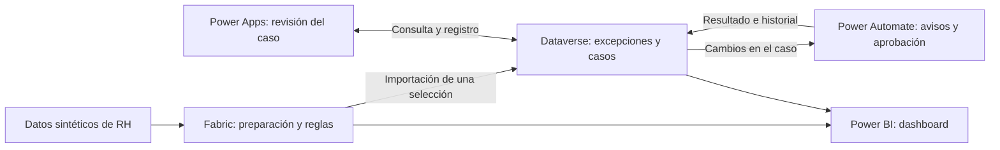

# Cómo está construido el proyecto 3

[← Caso principal](../README.md) · [English](technical-overview.en.md)

El proyecto sigue el recorrido de un problema de datos: detectarlo, decidir si requiere un caso, investigarlo y consultar el resultado. Fabric conserva el análisis completo. Dataverse guarda los casos de revisión, y Power Apps y Power Automate permiten gestionarlos. Power BI muestra lo que ocurre en ambos lados.



## 1. Preparar datos que permitan probar el proceso

El generador crea tres fuentes: registros de empleados, movimientos de personal y un catálogo de estructura organizacional. Utiliza una semilla fija e introduce errores conocidos para poder repetir el escenario y comprobar qué detecta cada regla.

Por ejemplo, DQ-007 compara el registro del empleado con sus movimientos ya completados. Si un cambio de puesto aún no aparece en el registro, la regla permite dos días hábiles para la sincronización. Sólo después de ese plazo señala la diferencia como un problema.

[Diseño de los datos](data-design.es.md) · [Reglas y tolerancias](quality-rules.es.md) · [Pruebas del generador](synthetic-data-validation.es.md)

## 2. Procesar y evaluar los datos en Fabric

El lakehouse sigue las capas Bronze, Silver y Gold. Bronze conserva los archivos originales. Silver prepara los tipos y la estructura, sin ocultar problemas como claves duplicadas. Gold aplica las ocho reglas y genera los resultados que se consultan en Power BI.

El historial permite saber si un problema vuelve a aparecer en otro snapshot, es decir, en otro corte de los datos. Ese análisis incluye todas las excepciones, aunque no se haya abierto un caso para revisarlas.

Los notebooks utilizan PySpark. Las vistas SQL exponen los resultados para Power BI y la selección de excepciones que se exporta a Dataverse.

[Implementación en Fabric](fabric-implementation.es.md) · [Notebooks](../notebooks/) · [Vistas SQL](../sql/)

## 3. Llevar una selección a Dataverse

Conviene distinguir tres registros: la excepción que detecta Fabric, su referencia importada a Dataverse y el caso que se crea para investigarla. Importar una excepción no abre automáticamente un caso.

Para la demostración se eligieron ocho excepciones, una por regla, mediante una consulta SQL y una importación. Esto permite probar distintos problemas sin cargar todos los resultados del análisis en la app. La selección es parte de la demostración; no hay un motor automático de priorización ni una sincronización continua con Fabric.

Dataverse guarda el responsable, el estado, las actividades y la evidencia de cada caso. Una clave alternativa impide crear dos casos para la misma instancia de excepción. La referencia importada se conserva por separado, de modo que la investigación no sobrescriba el problema original.

[Consulta de exportación](../sql/03_export_dataverse_demo_exceptions.sql) · [Modelo de Dataverse](dataverse-design.es.md) · [Pruebas de los controles](phase-5-gate-review.es.md)

## 4. Revisar y documentar desde Power Apps

El Command Center es una Generative Page desarrollada con React y TypeScript. Usa las API de Power Apps para consultar Dataverse y permite filtrar excepciones, ver su detalle y crear o abrir un caso. La edición completa se realiza en la model-driven app, que contiene los formularios y las vistas del caso.

La primera versión abría un formulario nuevo vacío. Como varios campos técnicos eran obligatorios y estaban bloqueados, no se podía completar el registro. La corrección consistió en crear primero el caso con la referencia de la excepción, el estado inicial, el responsable y las fechas necesarias. Después, la app abre ese registro por su GUID.

Una prueba con Playwright sobre la app publicada comprobó que el caso se creara antes de abrirse.

[Arquitectura de Power Apps](generative-page-architecture.es.md) · [Corrección y pruebas de la app](phase-6-gate-review.es.md) · [Código](../power-apps/)

## 5. Continuar el proceso con Power Automate

Power Automate gestiona las tareas que no deberían depender de mantener una pantalla abierta: notificar al responsable, comprobar los requisitos de una aprobación, esperar la respuesta y registrar el resultado en Dataverse.

Los flujos comprueban que exista la evidencia requerida y guardan identificadores para evitar repetir avisos o solicitudes. Si ocurre un error o se agota el tiempo de espera de una aprobación (timeout), lo registran en el historial del caso.

Se probaron las rutas de aprobación, rechazo, exención (estado Waived) y timeout. La reasignación entre dos usuarios quedó sin probar porque el entorno sólo tenía una cuenta. Los recordatorios periódicos de SLA tampoco forman parte de esta versión.

[Diseño de los flujos](phase-7-automation-design.es.md) · [Pruebas y limitaciones](phase-7-gate-review.es.md)

## 6. Consultar los resultados en Power BI

Power BI combina las vistas Gold de Fabric con las tablas de Dataverse mediante el modo Import. Para el volumen de esta demostración, permite actualizar ambas fuentes y comprobar que los totales coincidan. El modelo y el reporte están versionados en formatos PBIP, TMDL y PBIR.

El dashboard diferencia el cierre de un caso de la confirmación de que el dato se corrigió en el sistema de origen. Resolver un caso o aprobar una exención no demuestra que el error haya desaparecido. La aplicación no modifica un sistema real de RH.

La captura publicada muestra seis snapshots con 923 instancias de excepción, cinco casos creados y tres abiertos. Un mismo problema puede reaparecer en varios snapshots, por lo que esas 923 instancias no equivalen a 923 empleados ni a 923 casos distintos.

El Data Quality Score de 98.9% se calcula con las comprobaciones que aprobaron respecto de las que correspondía evaluar, ponderadas por severidad. No significa que el 98.9% de los empleados tenga todos sus datos correctos. La mejora de 0.7 puntos porcentuales está diseñada en el escenario sintético; no es un resultado atribuible a las automatizaciones.

[Modelo de Power BI y definición de métricas](phase-8-bi-design.es.md) · [Comprobación de resultados](phase-8-gate-review.es.md) · [Modelo y reporte](../power-bi/)

## Cómo utilicé IA y comprobé el trabajo

Me apoyé en IA para desarrollar la solución. Utilicé MCP para trabajar con el modelo semántico y herramientas de línea de comandos para generar y validar los archivos del proyecto. Las comprobaciones incluyen typecheck, pruebas de componentes, pruebas con Playwright y revisión visual.

La IA apoyó la construcción; la detección de errores utiliza las ocho reglas definidas en el proyecto. Cada una tiene condiciones explícitas que se pueden revisar y volver a ejecutar.

Los informes indican qué se probó en cada fase. Las fases 6 y 7 documentan pruebas sobre la app publicada y una creación controlada de un caso. La regresión local del 18 de octubre de 2026 no repitió las pruebas en navegador, la comparación visual ni la creación de registros.

[Evidencias y alcance de las pruebas](../evidence/phase-9/evidence-manifest.md)

## Qué haría falta para usarlo en una operación real

La solución se probó con datos sintéticos en un entorno de desarrollo. El siguiente paso sería acordar con el equipo qué problemas deben convertirse en casos y cómo confirmar las correcciones con los responsables de los sistemas de origen.

También habría que revisar permisos, conservación de datos, cargas incrementales, rendimiento y costos, además del despliegue entre entornos. Quedan pendientes las pruebas con distintos perfiles de acceso y con usuarios reales.

## Archivos para reproducir o ampliar el proyecto

[Diccionario de datos](data-dictionary.es.md) · [Operación de Power Platform](power-platform-maintenance.es.md) · [Plan de pruebas y publicación](phase-9-test-and-publication-plan.es.md)

Desde la carpeta del proyecto:

```powershell
python -m unittest discover -s scripts/tests -v
powershell -NoProfile -ExecutionPolicy Bypass -File scripts/verify_phase9.ps1
```

Para actualizar Power BI en tu entorno, sustituye los parámetros de ejemplo por el endpoint SQL de Fabric, la base del lakehouse y el entorno de Dataverse que correspondan. Las credenciales y la configuración local no están incluidas en el repositorio.
