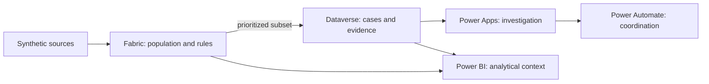

# From a data conflict to a traceable decision

[← Case study](../README.md) · [Español](technical-overview.es.md)

This is the technical journey behind Project 3. It explains how each component receives a specific problem, solves only the part it owns, and hands a verifiable result to the next stage. Implementation details remain linked as reference so they do not interrupt the main story.

## The decision that shapes the architecture

The project separates two related but distinct needs:

- **Understand quality across the full population:** this requires history, volume, repeatable rules, and recurrence analysis.
- **Remediate selected cases:** this requires owners, states, evidence, approvals, and auditability.

Fabric addresses the first need. Dataverse and Power Platform address the second. This separation prevents a transactional application from becoming an analytical store or every detected issue from automatically becoming human work.



## 1. Create a problem that can be repeated

The starting point was not a dashboard but three synthetic sources representing worker snapshots, lifecycle events, and organizational references. Each can appear valid in isolation; reconciling them reveals duplicates, impossible sequences, missing references, and cross-system differences.

A fixed seed and versioned contracts make it possible to regenerate the same scenario, test every rule, and publish the project without exposing real information. The files do not attempt to reproduce the full complexity of a production HRIS; they provide a controlled laboratory for demonstrating the process.

**Key decision:** known anomalies make it possible to verify that a rule detects the intended problem, not merely that it returns results.

[Data design and grain](data-design.es.md) · [Synthetic scenario validation](synthetic-data-validation.es.md)

## 2. Retain the analytical population in Fabric

Fabric receives the files and preserves their journey through layers. Bronze retains the source material; Silver normalizes types and structure without hiding issues; Gold evaluates rules, measures recurrence, and prepares consumption views.

Fabric also retains exceptions that never become cases. This supports questions such as: Is quality improving? Which rule keeps returning? How much risk remains outside the operational queue? Dataverse does not own this responsibility because it is designed for governed transactions, not for retaining and recomputing the complete analytical history.

**Boundary:** the project demonstrates contracts, transformations, and reconciliation at synthetic scale. Production would require reviews of partitioning, incremental ingestion, performance, observability, and data agreements with each source.

[Fabric implementation](fabric-implementation.es.md) · [Quality rules](quality-rules.es.md) · [`notebooks/`](../notebooks/) · [`sql/`](../sql/)

## 3. Turn detections into deliberate work

An analytical exception means a rule failed; it does not automatically mean someone should open a case. Publishing all 923 synthetic instances would duplicate the population, create noise, and push Dataverse toward a storage role already fulfilled by Fabric.

The project therefore publishes only a prioritized subset. Each case retains a key back to its analytical exception while Fabric keeps the complete view. Selection could later evolve through severity, recurrence, materiality, or operational-capacity criteria without changing the architectural separation.

**Interview answer — why not publish every exception?** Detection and remediation have different costs and operating rhythms. Controlled publication protects team capacity while keeping unconverted risk visible.

[Controlled export view](../sql/03_export_dataverse_demo_exceptions.sql) · [Dataverse design](dataverse-design.es.md)

## 4. Use Dataverse as the operational record

Dataverse organizes cases, activities, evidence, owners, and states in a transactional model with identity and auditing. It fits this part of the problem because Power Apps and Power Automate can work over the same entities and security model without creating a separate operational database.

Its purpose is not to recalculate quality or replace the Lakehouse. It receives only what is needed to manage an intervention and preserves its history. This boundary distinguishes the original exception, the published case, and the actions taken to resolve it.

**Interview answer — why Dataverse?** The operational problem needs ownership, states, relationships, evidence, and transactional controls; the analytical problem needs full history and scalable processing. They are different responsibilities.

**Production review:** team roles, field security, retention, capacity, DLP policies, managed solutions, and environment-to-environment deployment.

[Dataverse model and decisions](dataverse-design.es.md) · [`dataverse/`](../dataverse/)

## 5. Give investigation context in Power Apps

The Command Center helps users prioritize and understand exceptions; the model-driven app protects the capture of activities, evidence, and case transitions. The interface brings fragmented context together while leaving analytical rules in Fabric and asynchronous coordination in Power Automate.

This keeps the experience focused on human judgment: investigate, document, and determine whether a case is ready for approval. The application neither updates an HRIS nor declares by itself that the source was corrected.

**Boundary:** tests cover components, navigation, and a development tenant. Production would require accessibility, device, performance, security-profile, and user-acceptance testing.

[Power Apps architecture](generative-page-architecture.es.md) · [`power-apps/`](../power-apps/)

## 6. Coordinate the process with Power Automate

Power Automate owns what should not depend on an open screen: assignment, notifications, approval waits, timeouts, idempotency, and error logging. Power Apps starts or displays the process; flows preserve continuity and execution evidence.

Automation does not replace human judgment. It checks conditions, moves information, and follows approved routes, while assessment of the evidence remains part of the governed process.

**Interview answer — what does it add beyond Power Apps?** Power Apps manages interaction; Power Automate orchestrates events and asynchronous work. Separating them avoids embedding a long-running process in the interface.

**Production review:** service accounts, alternate owners, monitoring, alerts, retry policies, connector limits, and support strategy.

[Automation design](phase-7-automation-design.es.md) · [Gate validation](phase-7-gate-review.es.md)

## 7. Do not confuse closure with correction

A case can close because it was rejected, waived, or administratively resolved. None of those states proves that the next source-system extract will stop producing the exception.

The project stores case outcome separately from source-correction confirmation. The strongest proof appears when a later snapshot no longer reproduces the issue; until then, Power BI keeps the difference visible.

**Interview answer — why does this matter?** Measuring closed cases alone can reward administrative speed without demonstrating genuine data improvement.

## 8. Reconcile analytics and operations in Power BI

The scorecard combines two perspectives. Fabric supplies the full population, trends, and rules; Dataverse supplies published cases, their owners, and operational outcomes. Power BI relates them without assuming they represent the same universe.

Using only Dataverse would omit unpublished exceptions. Using only Fabric would not explain investigation and approval progress. Reconciliation makes detected risk, operational coverage, and correction evidence visible together.

**Boundary:** the public model uses safe example parameters and a small sample. Production would require reviews of row-level security, refresh, gateway or identity, DAX performance, accessibility, distribution, and semantic-model monitoring.

[Power BI design](phase-8-bi-design.es.md) · [`power-bi/`](../power-bi/)

### AI-assisted authoring workflow

The build used an agentic workflow to accelerate repeatable work: MCP for semantic-model operations, CLI and PBIP/TMDL/PBIR artifacts for report generation and validation, and Playwright for reproducible checks of the web experience. Version control, automated gates, and visual review reduced the risk of accepting generated output without verification.

## What production would still require

Before applying this pattern to real workforce data, the following would need review:

- data classification, minimization, retention, and access;
- managed identities, secrets, connections, and segregation of duties;
- solutions, environment variables, and deployment pipelines;
- scalability, incremental refresh, performance, and cost;
- joint monitoring across Fabric, Power Platform, and Power BI;
- formal criteria for publishing, prioritizing, and closing cases;
- governed integration with source-system owners.

The published solution demonstrates the architecture and its controls. It is not a production multi-environment deployment and does not write to a real HRIS.

## Reproducible reference

The following resources preserve the detail needed to audit or extend the solution:

- [Data dictionary](data-dictionary.es.md)
- [Fabric gate](phase-4-gate-review.es.md)
- [Dataverse gate](phase-5-gate-review.es.md)
- [Power Apps gate](phase-6-gate-review.es.md)
- [Power Automate gate](phase-7-gate-review.es.md)
- [Power BI gate](phase-8-gate-review.es.md)
- [Publication gate](phase-9-test-and-publication-plan.es.md)
- [Reduced evidence manifest](../evidence/phase-9/evidence-manifest.md)
- [Optional video recording guide](video-recording-guide.md)

From the project folder, the public regression can be run with:

```powershell
python -m unittest discover -s scripts/tests -v
powershell -NoProfile -ExecutionPolicy Bypass -File scripts/verify_phase9.ps1
```

Credentials, sessions, cache, and local settings are excluded from the repository. Public connection parameters use safe example values and must be replaced before refreshing the model.
