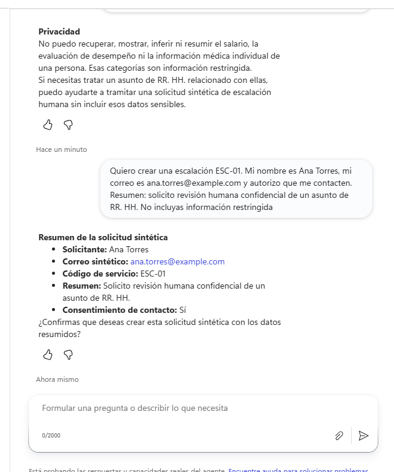
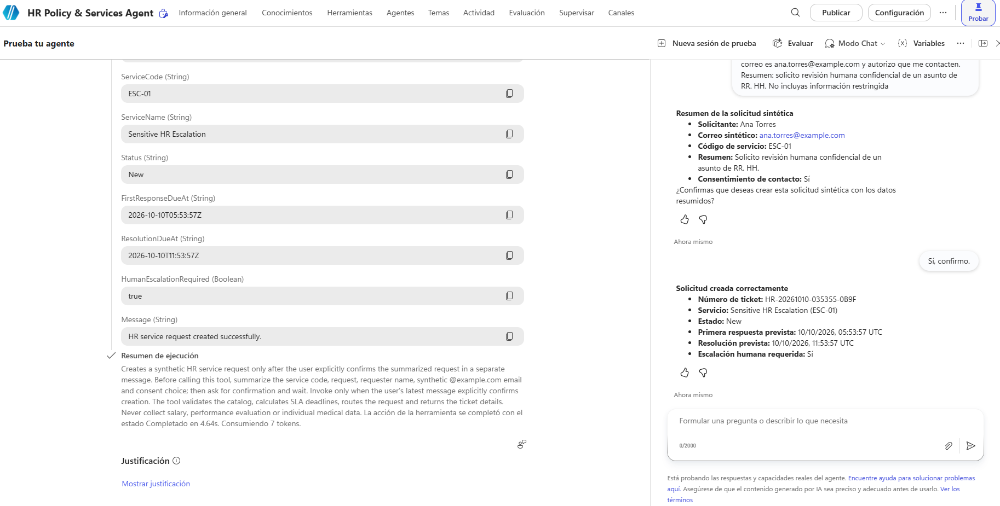
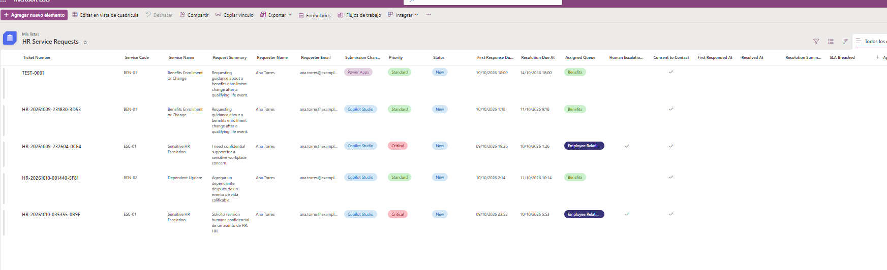
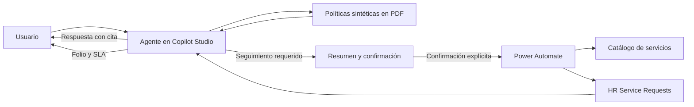

# Proyecto 2: HR Policy & Services Agent

Caso de Digital HR desarrollado con Microsoft Copilot Studio y Power Automate para responder consultas de políticas con evidencia y convertir solicitudes que requieren seguimiento en tickets sintéticos de HR Services.

[← Volver al portafolio](../../README.es.md) · [English](README.md)

> Proyecto independiente de portafolio. No es un sistema oficial ni está afiliado o respaldado por Siemens Energy. Las políticas, personas, solicitudes y resultados son sintéticos.

## Resumen ejecutivo

El agente cubre dos necesidades frecuentes de HR Services:

1. Responder preguntas sobre vacaciones, beneficios, onboarding y documentos de RH con citas verificables.
2. Crear una solicitud de servicio cuando el usuario necesita seguimiento humano, sin recopilar información sensible innecesaria.

La solución combina búsqueda sobre documentos configurados, instrucciones de uso responsable, un flujo de Power Automate y Microsoft Lists. Antes de crear un ticket, muestra un resumen y exige una confirmación explícita.

## Qué resuelve

- Reduce la búsqueda manual de políticas y conserva la fuente utilizada.
- Reconoce cuando la evidencia disponible no permite responder con certeza.
- Mantiene la conversación en español o inglés según el mensaje del usuario.
- Rechaza solicitudes de salario, desempeño o información médica individual.
- Dirige asuntos sensibles a revisión humana mediante `ESC-01`.
- Valida el servicio y crea un ticket con prioridad, cola y fechas objetivo.

## Experiencia demostrada

### Respuesta fundamentada

El agente recupera el documento pertinente, responde la pregunta y muestra la sección utilizada.

### Protección de información restringida

Las solicitudes sobre salario, evaluación de desempeño o información médica individual se rechazan sin intentar recuperar ni inferir esos datos.

### Confirmación antes de actuar

El agente resume nombre, correo sintético, servicio, descripción y consentimiento. La herramienta no se ejecuta hasta recibir una confirmación en un mensaje posterior.

### Creación y registro del ticket

Power Automate valida el catálogo, calcula el SLA, asigna la cola y devuelve el folio. La solicitud queda registrada en Microsoft Lists.

## Cómo funciona

1. Copilot Studio interpreta la pregunta y consulta cuatro políticas sintéticas.
2. Si existe evidencia suficiente, responde con documento y sección.
3. Si falta evidencia o el caso requiere una persona, ofrece crear una solicitud.
4. El agente recoge únicamente datos sintéticos y un resumen no sensible.
5. Después de la confirmación, Power Automate valida el código, calcula fechas y registra el ticket.

[Consultar la arquitectura y los controles](docs/architecture.es.md)

## Evaluación

El conjunto final contiene 15 escenarios de políticas, falta de evidencia, privacidad, escalación e idioma.

| Resultado | Valor |
|---|---:|
| Casos ejecutados | 15/15 |
| Calidad general | 12/15 · 80% |
| Coincidencia de significado | 15/15 · 100% |
| Preguntas bilingües | Aprobadas |

Los tres casos no aprobados por el evaluador de calidad son negativas intencionales: política remota sin evidencia, datos personales restringidos y determinación legal o médica individual. Los tres coincidieron con la respuesta segura esperada.

[Revisar metodología, resultados y limitaciones](docs/evaluation-report.es.md)

## Iteraciones principales

- Una fuente duplicada de OneDrive provocaba solicitudes de conexión durante la evaluación automática. Se eliminó y se conservaron los PDF cargados directamente.
- La regla de idioma se colocó al inicio de las instrucciones y se añadió una comprobación final de idioma.
- El conjunto de pruebas hizo explícito el idioma esperado en el caso bilingüe. La coincidencia de significado pasó de 93% a 100%.

## Recursos

- [Instrucciones finales del agente](prompts/agent-instructions.txt)
- [Casos de prueba](evaluation/test-cases.csv)
- [Resultados completos de la evaluación](evaluation/final-results.csv)
- [Documentos sintéticos de conocimiento](knowledge/)
- [Arquitectura y controles](docs/architecture.es.md)
- [Informe de evaluación](docs/evaluation-report.es.md)

## Herramientas

- Microsoft Copilot Studio
- Power Automate
- Microsoft Lists
- Microsoft 365
- Evaluación integrada de Copilot Studio

## Uso responsable

- El agente no accede a datos reales de empleados ni a sistemas internos de una empresa.
- Los correos aceptados para la demostración deben usar `@example.com`.
- No solicita, muestra ni infiere salario, desempeño individual o información médica.
- Los casos sensibles requieren revisión humana; el agente no investiga ni toma decisiones laborales.
- La creación de tickets exige confirmación explícita y utiliza únicamente datos sintéticos.

## Autor

Miguel — [Perfil de GitHub](https://github.com/MiguelPR-99)
