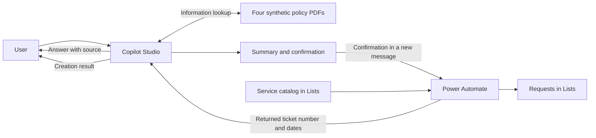

# Agent architecture and controls

[← Case study](../README.en.md) · [Español](architecture.md)

Copilot Studio manages the conversation and searches policies. Power Automate executes ticket creation. Microsoft Lists stores the service catalog and requests. This separation makes it possible to review the agent's answer and the action performed by the flow.

## Policy lookup

The four policies cover leave, benefits, onboarding, and HR documents. They were uploaded directly as PDFs in Copilot Studio. Retrieval and answer generation use the platform's knowledge features.

The instructions require answers to use information found in those sources and identify the document and section. When information is missing, the agent should acknowledge it and offer a follow-up request. The response language should follow the user's most recent message.

A duplicate OneDrive source caused connection prompts during automated evaluation. That source was removed while the directly uploaded PDFs were retained.

[Policy documents](../knowledge/) · [Full instructions](../prompts/agent-instructions.txt)

## Ticket creation

1. The agent collects the service code, a non-sensitive summary, a synthetic name, an @example.com email address, and consent to be contacted.
2. It displays a summary and asks for authorization to create the request. It must wait for a new message; contact consent alone does not authorize creation.
3. If the user changes the details, it displays the updated summary and requests confirmation again.
4. After confirmation, it calls Create HR Service Request. Power Automate validates the service against the active catalog.
5. The flow generates the ticket number, assigns priority, queue, and status, calculates target dates, and creates the record in HR Service Requests.
6. The agent should report successful creation only if the tool returns Success=true and a non-empty TicketNumber. If it fails, the agent should explain that creation could not be confirmed.

Any target dates communicated by the agent must come from the tool; it must not invent dates or service commitments.

## Where each control applies

| Process area | How the control is designed |
|---|---|
| Answers and language | Instructions define allowed sources, citations, and language. The fifteen published tests evaluate single-turn answers. |
| Confirmation | Instructions require a summary and a later user message before calling the tool. The demonstration shows this flow. |
| Service and record | The flow design documents catalog validation and ticket creation in Lists. The demonstration shows the stored result. |
| Restricted information | Instructions prohibit requesting or revealing restricted personal data. Evaluation questions and a refusal screenshot are published. |
| Sensitive matters | The agent should offer an ESC-01 human-review request using a non-sensitive summary and synthetic contact details. |

The instruction to make one call per confirmation reduces the risk of repeating an action, but does not establish flow idempotency under retries. Similarly, refusal tests show behavior in those scenarios; instructions do not replace environment permissions and access controls.

## Scope of the published material

The repo includes synthetic policies, instructions, test questions, results, and a demonstration. It does not include an importable agent or flow export, so cloning it does not automatically recreate the solution.

Running it in another environment requires authenticated Power Platform connections, the lists, and tool configuration. Tenant identifiers and credentials are not published.

[Full demonstration](../README.en.md#end-to-end-demonstration) · [Evaluation and test limitations](evaluation-report.en.md)
