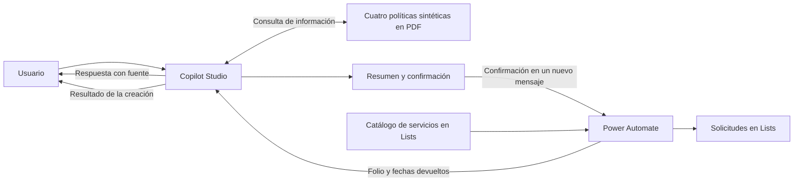

# Arquitectura y controles del agente

[← Caso principal](../README.md) · [English](architecture.en.md)

Copilot Studio gestiona la conversación y consulta las políticas. Power Automate ejecuta la creación del ticket. Microsoft Lists guarda el catálogo de servicios y las solicitudes. Esta separación permite revisar la respuesta del agente y la acción que realiza el flujo.

## Consulta de políticas

Las cuatro políticas cubren ausencias, beneficios, onboarding y documentos de RH. Se cargaron directamente como PDF en Copilot Studio. La búsqueda y la generación de respuestas utilizan las funciones de conocimiento de la plataforma.

Las instrucciones piden responder sólo con información encontrada en esas fuentes e identificar el documento y la sección. Si falta información, el agente debe reconocerlo y ofrecer una solicitud de seguimiento. El idioma de respuesta debe corresponder al mensaje más reciente del usuario.

Una fuente duplicada de OneDrive provocó solicitudes de conexión durante la evaluación automática. Se retiró esa fuente y se conservaron los PDF cargados directamente.

[Políticas utilizadas](../knowledge/) · [Instrucciones completas](../prompts/agent-instructions.txt)

## Creación del ticket

1. El agente reúne el código de servicio, un resumen no sensible, nombre sintético, correo terminado en @example.com y autorización para que RH lo contacte (Consent to Contact).
2. Muestra un resumen y pide confirmación para crear la solicitud. Debe esperar un nuevo mensaje; el permiso para contactar al usuario no autoriza por sí solo la creación.
3. Si el usuario cambia los datos, presenta el resumen actualizado y vuelve a pedir confirmación.
4. Después de la confirmación, llama a Create HR Service Request. Power Automate valida el servicio contra el catálogo activo.
5. El flujo genera el folio, asigna prioridad, cola y estado, calcula las fechas de atención y crea el registro en HR Service Requests.
6. El agente sólo debe comunicar una creación exitosa si la herramienta devuelve Success=true y un TicketNumber no vacío. Si falla, debe explicar que la creación no se pudo confirmar.

Los plazos que comunica el agente deben ser los devueltos por la herramienta; no puede inventar fechas ni promesas de atención.

## Dónde se aplica cada control

| Parte del proceso | Cómo está planteado el control |
|---|---|
| Respuestas e idioma | Las instrucciones definen las fuentes permitidas, las citas y el idioma. Las quince pruebas publicadas evalúan respuestas de una sola interacción. |
| Confirmación | Las instrucciones exigen mostrar el resumen y esperar otro mensaje antes de llamar a la herramienta. La demostración muestra este recorrido. |
| Servicio y registro | El diseño del flujo documenta la validación contra el catálogo y la creación del ticket en Lists. La demostración muestra el resultado guardado. |
| Información restringida | Las instrucciones prohíben solicitar o revelar datos personales restringidos. Se publican preguntas de evaluación y una captura de rechazo. |
| Asuntos sensibles | El agente debe ofrecer una solicitud ESC-01 para atención humana, con un resumen no sensible y datos de contacto sintéticos. |

La instrucción de realizar una llamada por confirmación reduce el riesgo de repetir una acción, pero no demuestra que el flujo tenga idempotencia ante reintentos. Del mismo modo, las pruebas de rechazo muestran el comportamiento en esos escenarios; las instrucciones no sustituyen los permisos y controles de acceso del entorno.

## Alcance de lo publicado

El repo incluye políticas sintéticas, instrucciones, preguntas de prueba, resultados y una demostración. No incluye una exportación importable del agente o del flujo, por lo que clonarlo no reconstruye automáticamente la solución.

Para ejecutarla en otro entorno se necesitan las conexiones autenticadas de Power Platform, las listas y la configuración de la herramienta. Los identificadores del tenant y las credenciales no están publicados.

[Demostración completa](../README.md#demostración-end-to-end) · [Evaluación y límites de las pruebas](evaluation-report.md)
