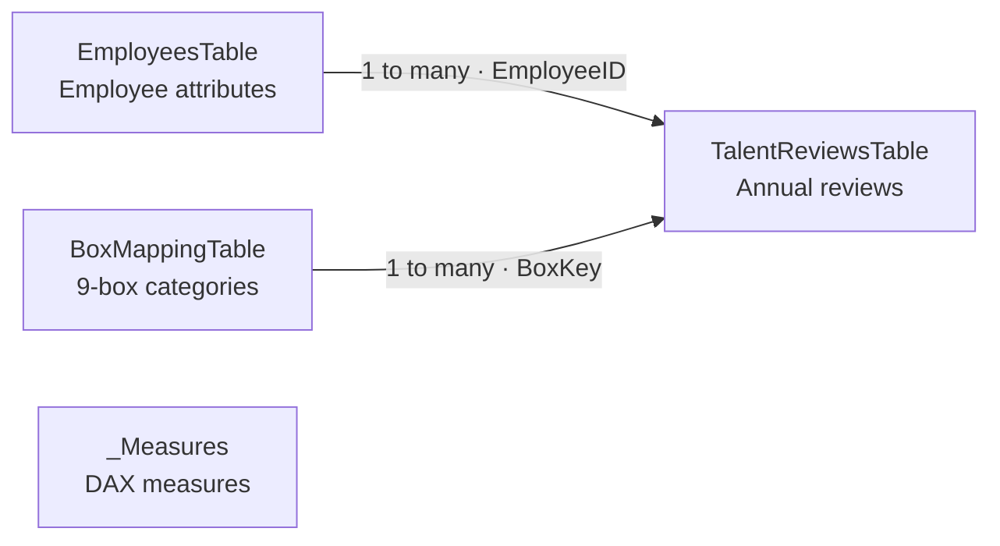

# Data model and implementation notes

[← Back to the case](../README.en.md) · [Español](data-model.md)

## Structure

The unit of analysis is one employee review per period. The model separates employee attributes, annual reviews, and the mapping to 9-box categories.

| Table | Contents |
|---|---|
| `EmployeesTable` | One row per synthetic employee: name, position, department, business unit, and manager |
| `TalentReviewsTable` | One row per employee and period: performance, potential, position key, and movement fields |
| `BoxMappingTable` | Mapping from score combinations to 9-box labels, sort order, and visual attributes |
| `_Measures` | Explicit DAX measures grouped for easier reference |

## Modeling decisions

- Relationships are one-to-many with single-direction filtering.
- Employee and period filters define the reviews being analyzed.
- The 9-box classification is kept separate from review records.
- Measures handle filter context explicitly, without bidirectional relationships.
- Employee counts use distinct `EmployeeID` where a person may have more than one record.
- Technical columns that report authors do not need are hidden.

Grouping measures in `_Measures` makes them easier to find; the table is not a business entity and does not add a relationship to the model.

## Analytical decisions

Movement considers both rating axes. When one rises and the other falls, the Mixed classification is retained. For calibration, the benchmark depends on the selected population and must be read alongside the active filters and employee counts.

Talent Balance summarizes two matrix cells. Interpreting a department also requires reviewing the other categories and group size. Definitions and examples are in the [metric dictionary](metric-dictionary.en.md).

The four pages separate distribution, movement, calibration, and department comparison. Dynamic headlines and notes help explain each selection, subject to the case's [interpretation limits](responsible-use.en.md).

## Checks performed during development

- Measures were compared with the Excel source under different period and department filters.
- The first period was checked because it has no prior review for movement classification.
- A metadata query was used to check explicit measure validity and placement in `_Measures`.

These checks apply to the synthetic-data exercise. They do not validate the rating criteria, calibration threshold, or usefulness in a real organization.

The case includes a published demo, screenshots, and a [downloadable PBIX](../power-bi/Project-0-Talent-Review-Calibration.pbix). Opening the file requires Power BI Desktop; demo availability depends on its publication in Power BI.
