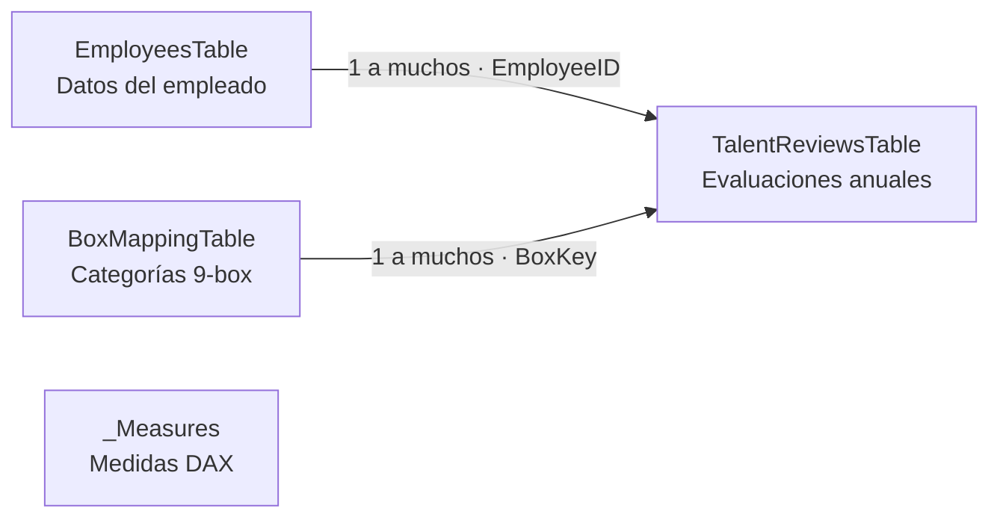

# Modelo de datos y notas de implementación

[← Volver al caso](../README.md) · [English](data-model.en.md)

## Estructura

La unidad de análisis es una evaluación por empleado y periodo. El modelo separa los atributos del empleado, las evaluaciones anuales y la correspondencia con las categorías 9-box.

| Tabla | Contenido |
|---|---|
| `EmployeesTable` | Una fila por empleado sintético: nombre, puesto, departamento, unidad de negocio y manager |
| `TalentReviewsTable` | Una fila por empleado y periodo: desempeño, potencial, clave de posición y campos de movimiento |
| `BoxMappingTable` | Correspondencia entre las combinaciones de puntajes y sus etiquetas 9-box, orden y atributos visuales |
| `_Measures` | Medidas DAX explícitas, reunidas para facilitar su consulta |

## Decisiones de modelado

- Las relaciones son de uno a muchos, con una sola dirección de filtrado.
- Los filtros de empleado y periodo delimitan las evaluaciones que se analizan.
- La clasificación 9-box se mantiene separada de los registros de evaluación.
- Las medidas gestionan el contexto de filtro de forma explícita, sin relaciones bidireccionales.
- Los conteos de empleados usan `EmployeeID` distinto cuando puede haber más de un registro por persona.
- Las columnas técnicas que no necesita quien construye el reporte permanecen ocultas.

Reunir las medidas en `_Measures` facilita encontrarlas; esa tabla no representa una entidad del negocio ni añade una relación al modelo.

## Decisiones de análisis

El movimiento considera los dos ejes de la evaluación. Cuando uno sube y el otro baja, se conserva la clasificación Mixed. En calibración, la referencia depende de la población seleccionada, por lo que debe revisarse junto con los filtros activos y el número de empleados.

Talent Balance resume dos celdas de la matriz. Para interpretar un departamento, también hay que revisar las otras categorías y el tamaño del grupo. Las definiciones y los ejemplos están en el [diccionario de métricas](metric-dictionary.md).

Las cuatro páginas separan distribución, movimiento, calibración y comparación departamental. Los titulares dinámicos y las notas ayudan a leer cada selección, con las [precauciones de interpretación](responsible-use.md) del caso.

## Comprobaciones realizadas durante el desarrollo

- Contraste de medidas con el archivo de Excel bajo distintos filtros de periodo y departamento.
- Revisión del primer periodo, que no tiene una evaluación anterior para clasificar movimientos.
- Consulta de metadatos para comprobar la validez de las medidas explícitas y su ubicación en `_Measures`.

Estas comprobaciones corresponden al ejercicio con datos sintéticos. No constituyen una validación de los criterios de evaluación, del umbral de calibración ni de su utilidad en una organización real.

El caso incluye una demo publicada, capturas y el [PBIX descargable](../power-bi/Project-0-Talent-Review-Calibration.pbix). Para abrir el archivo se necesita Power BI Desktop; la disponibilidad de la demo depende de su publicación en Power BI.
